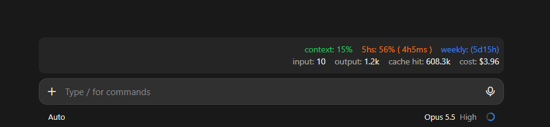

# cc-usage

A Claude Code mod that shows your current usage right-aligned above the prompt box.

## Install

From a shell:

```bash
claude plugin install cc-usage --marketplace william-garden/cc-usage
```

At the prompt of a terminal session:

```
/plugin install cc-usage --marketplace william-garden/cc-usage
```

In the desktop app, where `/plugin` does not run: click + next to the prompt box, then Plugins, Add marketplace with `william-garden/cc-usage`, then Add plugin.

Answer `y` to add the marketplace, then pick the user scope so it loads in every session.

To update later:

```bash
claude plugin marketplace update cc-usage
claude plugin update cc-usage@cc-usage
```

## What it shows



```
context: 25%  5hs: 30% ( 2h30ms )  weekly: (2d10h)
input: 12.3k  output: 4.5k  cache hit: 1.2M  cost: $0.42
```

- **context**: how full the current context window is
- **5hs**: 5-hour rate-limit usage and time until it resets
- **weekly**: time until the weekly limit resets (the color reflects weekly usage)

- **input / output**: the latest turn's uncached input tokens and output tokens (not summed across turns)
- **cache hit**: input tokens the latest turn read from the prompt cache
- **cost**: this session's total estimated cost in US dollars

Each section of the first row is colored by its usage: under 25% green, 25–55% blue, 55–75% orange, 75–100% a rainbow gradient that runs red to violet once across the section.

The numbers come from Claude's own rate-limit readings, so no token or setup is needed. They appear after the first API response of a session, and the rate-limit sections need a Claude subscription (Pro/Max).
